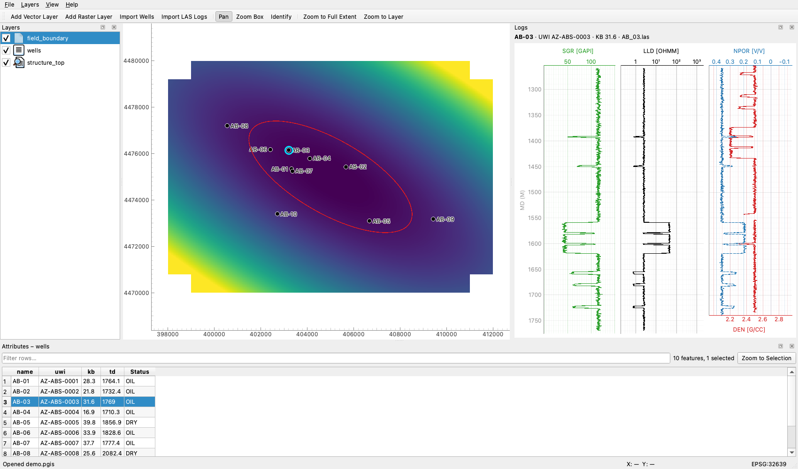

# PetroGIS

A cross-platform desktop GIS for petroleum engineering and reservoir geology. PetroGIS focuses on
what general-purpose GIS tools handle poorly: wells, well logs and subsurface data, on a fast map
canvas. It is domain-focused, not a QGIS clone.



*The synthetic Absheron demo field: a structure-top GeoTIFF, the field boundary and ten wells. On
the right are well AB-03's logs, with the reservoir at about 1560–1620 m MD showing low GR, high
resistivity and neutron–density crossover.*

## Features (Phase 1)

- **Map:** pan, wheel and box zoom, zoom to layer or full extent, and live cursor coordinates. Every
  layer is reprojected to the project CRS (default EPSG:32639, WGS 84 / UTM 39N).
- **Vector layers:** Shapefile, GeoJSON, GeoPackage (layer picker) and KML, with a single-colour
  style editor. If a source has no CRS, PetroGIS asks for one.
- **Raster layers:** GeoTIFF with colormaps and value-range controls. Only the visible window is
  read, at screen resolution, so large rasters stay fast.
- **Wells:** import headers from CSV or Excel. Columns are detected automatically, and a mapping
  dialog appears when detection fails. Wells show as symbols with labels that thin out instead of
  overlapping.
- **LAS logs:** import many files at once. Logs are matched to wells by normalised name, then UWI,
  then file name. Curve mnemonics are resolved through an alias table (GR/GR_EDTC/SGR, ILD/LLD/RT, …).
- **Log viewer:** click a well to see GR, deep resistivity (log scale) and an NPHI + RHOB overlay
  on one shared depth axis, with depth increasing downwards.
- **Identify and attribute table:** click features to see their attributes and the raster value
  there. The attribute table sorts, filters, highlights the selection on the map and zooms to it.
- **Projects:** `.pgis` files (JSON) store layer sources (relative paths), styles, order, the CRS,
  the view and attached logs. There is a recent-projects list.

## Quick start

Requires [uv](https://docs.astral.sh/uv/). uv installs the pinned Python (3.12) and all
dependencies.

```bash
uv sync
```

Generate the synthetic demo field into `sample_data/`:

```bash
uv run python scripts/make_sample_data.py
```

Start the app:

```bash
uv run petrogis
```

Then load the demo:

1. **Layers → Add Raster Layer…** → `sample_data/structure_top.tif`
2. **Layers → Add Vector Layer…** → `sample_data/field_boundary.geojson`
3. **Layers → Import Wells…** → `sample_data/wells.csv`
4. **Layers → Import LAS Logs…** → select every file in `sample_data/las/`. `OFFSET_1.las` is a
   deliberately unmatched offset well and is reported as such.
5. Click a well to open its logs. Use **File → Save Project As…** to save the session.

To open a saved project directly:

```bash
uv run petrogis path/to/project.pgis
```

## Keyboard shortcuts

| Action | Shortcut |
|---|---|
| New / Open / Save / Save As project | Ctrl+N / Ctrl+O / Ctrl+S / Ctrl+Shift+S |
| Add vector / raster layer | Ctrl+Shift+V / Ctrl+Shift+R |
| Import wells / LAS logs | Ctrl+Shift+W / Ctrl+Shift+G |
| Pan / Zoom box / Identify mode | P / Z / I |
| Zoom to layer / full extent | Ctrl+Shift+L / Ctrl+Shift+F |
| Open attribute table | F6 |
| Clear selection highlight | Esc |
| Remove selected layer (in layer panel) | Delete |

On macOS, Ctrl is ⌘.

## Development

```bash
uv run pytest                                          # tests (Qt tests run offscreen)
uv run ruff check . && uv run ruff format --check .    # lint + format
uv run python scripts/screenshot.py out.png --demo     # offscreen screenshot with the demo loaded
```

The code is organised in layers. `core/` and `io/` are pure Python and never import Qt. `render/`
holds the swappable map renderer, `ui/` the PySide6 application, and `analysis/` will hold the
Phase 2 algorithms. [CLAUDE.md](CLAUDE.md) has the architecture rules, performance rules and
conventions. [ROADMAP.md](ROADMAP.md) tracks progress, and [docs/phase2.md](docs/phase2.md)
describes how the planned subsurface features plug in.

## Status

Phase 1 is complete. Phase 2 will add deviation surveys, formation tops, gridding and contours,
volumetrics with Monte Carlo, cross-sections, 3D, SEG-Y, a plugin API and installers.
